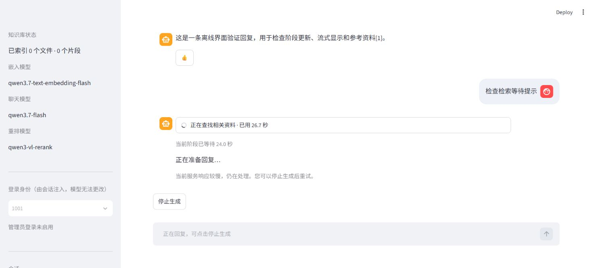
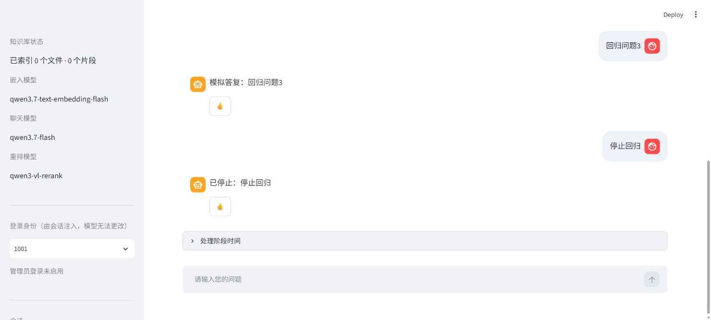
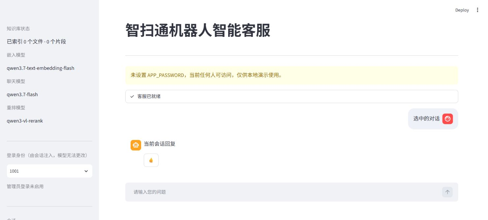

# 问答速度与等待反馈优化

本轮针对“回复慢、等待时没反馈”。修改已写入项目，重新启动应用后使用。当前模型名称、知识库文件及历史数据库保持原配置；在线测试在隔离副本使用内存会话。

## 找到的问题与改动

| 问题 | 本轮处理 |
|---|---|
| 仅在已有工具结果后关闭模型思考，首次决策仍可能等待很久 | 新增 `decision_disable_thinking: true`，独立控制首次工具选择及闲聊；可设为 `false` 做对照 |
| 天气等工具开始后，页面还可能显示“模型思考中” | 完整消费工具开始、结束和真实阶段，显示理解问题、查询资料、生成回复等状态 |
| 发消息时同步再读一次历史，整页重跑还读取会话列表 | 提交回调直接启动任务并复用当前用户、当前会话的已加载历史；运行时跳过会话列表读取 |
| 排队、检索和生成过程难以区分 | 动画状态条显示当前阶段、总耗时及阶段用时；可展开查看过程，完成后显示开始出字时间 |
| 聊天沿用建库的 120 秒超时及 3 次重试 | 聊天单独配置 45 秒请求超时、默认 0 次 SDK 重试，失败后从页面重试；embedding 建库策略保留 |
| 网络退避只写日志，停止要等退避结束 | 显示自动重试状态，退避可以被取消事件唤醒，时间预算过期后不再发起下次请求 |
| 配置锁等待发生在首屏或首个事件之前 | 登录首屏不再等待配置锁；后台等待服务配置前先发进度事件 |
| 进度域与模型运行上下文使用不同截止时间 | 统一取最早截止时间，避免排队耗时后又延长模型预算 |
| `[1,2]` 这类分组引用会误回退，未知分组可能漏检 | 逐项验证单号和分组引用，拒绝不存在的编号和损坏格式；模型调用次数不增加 |

主要文件：`app.py`、`utils/jobs.py`、`utils/progress.py`、`utils/retry.py`、`agent/react_agent.py`、`agent/tools/middleware.py`、`agent/grounding.py`、`model/factory.py` 及两个配置文件。

## 在线对照

两组使用同一脚本、同一份 330 块的活动知识库，模型均为 `qwen3.7-flash` / `qwen3.7-text-embedding-flash` / `qwen3-vl-rerank`。客户端预先初始化；计时从问答事件流开始，不包含首次导入和建库。每道主测试题前后各调用一次，因此数字描述本轮样本，不是稳定平均延迟或服务承诺。

“答复首字”排除工具调用前稍后会被清除的临时文字。

| 场景 | 答复首字：修改前 → 修改后 | 总用时：修改前 → 修改后 | 结果 |
|---|---:|---:|---|
| 用一句话介绍客服能力 | 3.453 → 0.875 秒 | 3.984 → 1.250 秒 | 正常介绍，无工具 |
| 未提供城市询问天气 | 12.516 → 1.547 秒 | 12.656 → 1.688 秒 | 正确询问城市，均调用一次城市工具，没有联网天气请求 |
| HEPA 滤网更换周期 | 3.781 → 2.593 秒 | 4.046 → 2.781 秒 | 修改后首次样本触发原文回退，不能当作质量等价的简洁答案 |

天气询问在修改前到第 12 秒才决定调用城市工具，修改后约第 0.84 秒进入工具；该样本的主要等待来自首次模型决策。

针对 HEPA 回退只追加了一次诊断复测，正常返回“根据知识库，HEPA 滤网建议每 3–6 个月更换一次[1][2]”，引用有效，首字 2.750 秒、总用时 3.031 秒。首次回退的候选文本没有被记录，无法确认具体原因；前后的生成与核对流程当时相同，不能将回退归因于加速开关。随后修复的是离线可确定复现的引用分组解析缺口，不能断言它解决了该次在线回退。

原始结果与诊断均保留：

- [修改前事件与答复](eval/latency-before-2026-10-30.json)
- [修改后事件与答复](eval/latency-after-2026-10-30.json)
- [对照汇总](eval/latency-comparison-2026-10-30.json)
- [HEPA 单次诊断复测](eval/grounding-probe-2026-10-30.json)

## 验证

在 `D:\anaconda3\envs\time\python.exe`，Python 3.10.20 下验证：

- 修改前基线：194 项离线测试通过。
- 修改后：232 项离线测试全部通过，共新增 38 项，25.546 秒。
- 58 个 Python 文件通过 `py_compile`。
- 真实 HTTP mock 验证了首次决策参数、请求超时及工具身份注入。
- 页面测试验证了立即回显、历史复用、天气等待状态、停止状态、最终回复只展示一次及输入恢复。
- 实际浏览器用隔离的模拟慢请求验证了阶段更新、流式正文、停止及完成后的输入恢复。

全套测试在不含真实 `.env` 或业务数据库的新副本中运行。受检 72 个源码、配置、语料文件的聚合 SHA256 为 `77acce7ba8f662a2f180b678a640ff7fab81f8358d0099ebe61746d8c0b94bc2`。验证摘要见 [JSON](eval/validation-2026-10-30.json)。

等待界面截图来自模拟慢请求，用于展示交互；在线速度来自上述独立模型测试。



## 使用

在 `Agent项目` 目录重新启动：

```powershell
& 'D:\anaconda3\envs\time\python.exe' -m streamlit run app.py
```

首次启动仍有依赖导入和必要的建库成本。停止是协作式的：已发出的网络请求要等待返回或超时；重试退避可以立即中止。`turn_timeout` 仍是调用边界预算，并非强制结束网络请求的进程级硬超时。

后续如继续提高质量，应扩大短追问和引用格式的在线题集；本轮三题样本不足以证明所有问题的回答质量和速度。

## 追加修复：回复完成后缺失 fragment

用户反馈连续问答完成后出现 `The fragment with id ... does not exist anymore`。这是 Streamlit 丢弃迟到的页面刷新请求时记录的日志。

旧进度组件只在问答运行中注册，完成后的整页重绘会移除它；同时 Streamlit 的 fragment ID 包含调用位置，历史消息变多也会改变 ID。浏览器此前已排队的刷新请求仍携带旧 ID，因而连续产生提示。

修复仅涉及页面布局与刷新生命周期：

- 初始化提示占用固定布局槽，历史和当前提问放入固定容器。
- 进度 fragment 每次都在固定位置注册；空闲状态仍保留注册，关闭定时刷新。
- 后台完成时整页重绘一次，加载最终历史、恢复输入，并关闭旧定时器。
- 迟到请求在空闲、任务不存在或身份/会话不匹配时直接返回。

新增 6 项真实 ScriptRunner 回归，覆盖冷启动、完成、取消、下一轮历史增长、已完成后的身份/会话切换及迟到请求。探针对旧代码复现了缺失警告；修复后同样的请求正常处理。

追加修复后全套 **238 项测试通过**，42.095 秒；59 个 Python 文件编译通过。73 个源码、配置及语料文件的聚合 SHA256 为 `159c71ed0777b31a695839005fad5854b0f36949513b97528592d6624b69e0ff`。

隔离真实浏览器连续完成三轮模拟问答及一次停止操作，三条答复均只显示一次，输入恢复可用，测试服务没有输出缺失 fragment 日志。没有调用在线模型或重启用户原有的 8501 服务。

摘要：[fragment 验证结果](eval/fragment-validation-2026-10-30.json)。重新启动 Streamlit 并刷新浏览器，可加载修复并清理此前的刷新队列。已有对话历史继续保留。



## 追加修复：刷新跳回“你好（14轮）”

浏览器刷新建立新的页面会话，原来的 `st.session_state` 不再保存用户刚选择的会话。旧初始化逻辑固定使用默认用户 `1001` 和主会话 `user-1001`；该会话的第一条消息为“你好”，已有14轮历史，因此刷新后看起来跳转到了这个旧对话。

新增 `utils/chat_session.py`，在 URL 的 `user` / `chat` 参数中保存当前演示用户和会话 ID。只在页面状态缺失时从地址恢复，避免旧 URL 覆盖刚切换的会话。切换用户、选择历史、新建及确认删除都会在重绘前同步地址；其他参数及其重复值保留。

恢复使用后端原有归属校验，兼容同用户的自定义 Unicode 会话 ID。地址不保存聊天正文、密码或管理员令牌。新建空会话、默认20条列表之外的旧会话也不因列表中暂未出现而丢弃。

新增8项回归，使用全新的 AppTest 实例且仅复制 URL 模拟刷新，覆盖恢复当前对话、两个用户、自定义 Unicode ID、切换/新建/删除、非法归属、密码门禁和稳定 fragment ID。全套 **246 项测试通过**，65.703 秒；61 个 Python 文件编译通过。75 个源码、配置及语料文件的聚合 SHA256 为 `6c879ad15fdccf0bb0fcc19d78478d1f00c7998f1460b66622f898a056666b5c`。

实际浏览器用隔离的模拟14轮主会话验证：选择其他对话后刷新，地址和对话都保持不变，旧主会话消息显示数量为0；新建空会话刷新前后也保持同一个 ID，输入可用。未调用在线模型或修改业务数据库。

修复之前已经丢失的选择无法可靠还原。更新后先从侧栏选回目标会话一次，此后刷新会恢复它。直接打开没有 `user` / `chat` 参数的根地址仍采用原来的默认主会话。

验证摘要：[会话恢复结果](eval/session-restore-validation-2026-10-30.json)。


